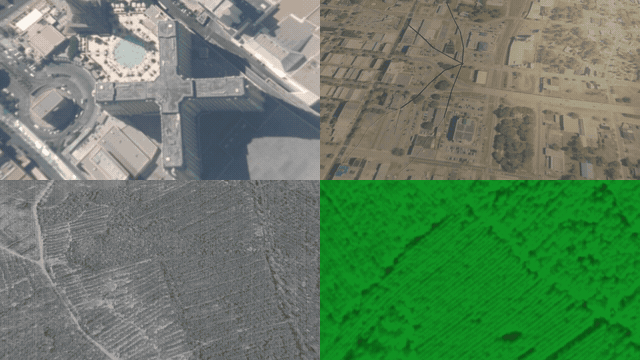
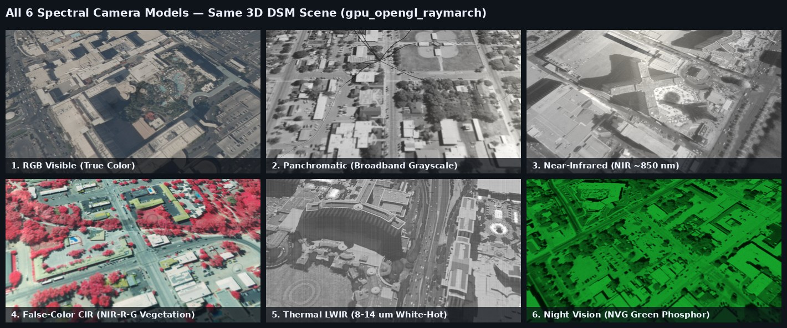
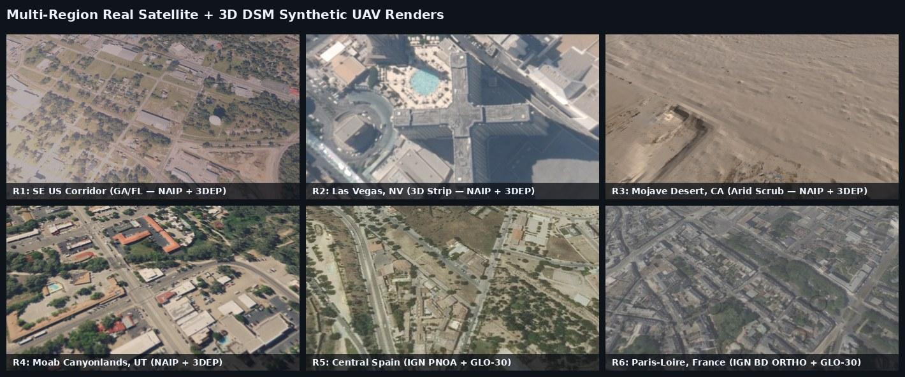
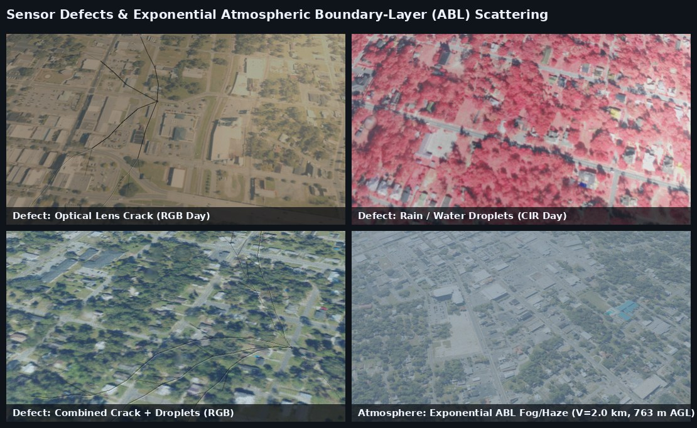
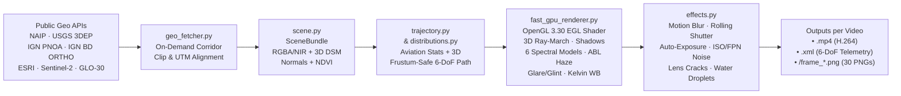

# Satellite-to-UAV Synthetic Flight Video Generator (`sat2uav`)

[](pyproject.toml)
[](src/sat2uav/fast_gpu_renderer.py)
[](tests/test_pipeline.py)
[](REGIONS_AND_PARAMS.json)

**`sat2uav`** is a physics-grounded, GPU-accelerated synthetic Unmanned Aerial Vehicle (UAV) flight video generator driven by **real public satellite/aerial orthoimagery (RGB + NIR)** and **3D Digital Surface Models (LiDAR DSM / Copernicus DEM)**.

It generates large-scale, ground-truth-annotated UAV sorties (`10.0 s @ 30 FPS`, `.mp4` + lossless keyframe `.png` stacks + 300-frame 6-DoF `.xml` telemetry) across **8 global geographic regions** (including **2 regions anchored directly to real GPS/heading UAV benchmarks** — China *UAV-VisLoc* and Kenya *KABR*) to support **cross-view geo-localization, visual odometry, GPS-denied navigation, and multi-spectral aerial perception**.

---

## Live Sample Output & Visual Showcase

### 4-Panel Animated Multi-Spectral UAV Flight Preview
*(Top-Left: Las Vegas 3D Strip RGB Day · Top-Right: South Georgia Optical Lens Crack RGB · Bottom-Left: Thermal LWIR · Bottom-Right: Night Vision NVG)*



> **Direct Sample Video (10s H.264, 480p, 0.57 MB):** [`docs/assets/sample_uav_flight_las_vegas.mp4`](docs/assets/sample_uav_flight_las_vegas.mp4) — oblique 3D flight over Las Vegas Strip (`R2_LAS_VEGAS_NV`) with real USGS 3DEP building parallax, dynamic solar shadows, and velocity-coupled motion blur.

### All 6 Spectral Camera Models (Same 3D DSM Scene)


### Multi-Region Real Satellite + 3D DSM Showcase


### Optical Defects & Exponential Boundary-Layer (ABL) Fog/Haze Scattering


---

## System Architecture



---

## Confirmed Global Regions & Real-UAV Validation Anchors

All 8 regions enforce a **100–300 km land-focused geofence radius** (`REGIONS_AND_PARAMS.json`) and fetch distinct corridors on demand via open APIs (no API keys required):

| ID | Region | Origin (Lat, Lon) | Radius | Terrain & Difficulty Regime | Open Data Stack | Role |
| :-: | :--- | :--- | :-: | :--- | :--- | :---: |
| **R1** | South Georgia / North Florida *(USA)* | `31.1500°N, 82.8500°W` | 120 km | Dense canopy, wetlands, metro edge, humid mist | NAIP (RGB+NIR) + USGS 3DEP DSM | Train / Benchmark |
| **R2** | Las Vegas, NV *(USA)* | `36.1699°N, 115.1398°W` | 120 km | High-rise 3D urban-to-desert edge, night lights | NAIP (RGB+NIR) + USGS 3DEP DSM | Train / Benchmark |
| **R3** | West/Central Mojave Desert, CA *(USA)* | `35.0200°N, 117.1800°W` | 110 km | Feature-sparse arid scrub, blowing dust events | NAIP (RGB+NIR) + USGS 3DEP DSM | Train / Benchmark |
| **R4** | Moab / Canyonlands, UT *(USA)* | `38.5733°N, 109.5498°W` | 300 km | Steep canyons, mesas, extreme 3D relief & shadows | NAIP (RGB+NIR) + USGS 3DEP DSM | Train / Benchmark |
| **R5** | Central Spain: Madrid–Toledo–La Mancha | `39.9500°N, 3.6500°W` | 200 km | Semi-arid Iberian plateau, Calima dust haze | **IGN PNOA** WMS + Copernicus GLO-30 | Train / Benchmark |
| **R6** | Paris–Loire Basin: Orléans–Paris *(France)* | `47.9000°N, 2.0000°E` | 180 km | Dense EU urban, river corridors, radiation fog | **IGN BD ORTHO + IRC** + GLO-30 | Train / Benchmark |
| **R7** | Shiyan / Zhushan Valleys, Hubei *(China)* | `32.3602°N, 109.6466°E` | 200 km | Subtropical mountain valleys, terraced farms | ESRI World + Sentinel-2 NIR + GLO-30 | **Real-UAV Paired** (*UAV-VisLoc*) |
| **R8** | Mpala Research Centre, Laikipia *(Kenya)* | `0.3839°N, 36.8806°E` | 180 km | Equatorial highland acacia savanna | ESRI World + Sentinel-2 NIR + GLO-30 | **Real-UAV Paired** (*KABR DJI SRT*) |

---

## Aviation-Grounded Statistical Distributions

Every flight and optical parameter is sampled from physically and operationally justified aeronautical distributions (documented in Standard Aviation English in [`update_logs/2026-11-23_log_004_aviation_parameters_and_engines.md`](update_logs/2026-11-23_log_004_aviation_parameters_and_engines.md) and [`update_logs/2026-11-23_log_006_abl_haze_and_lwir_agc_fix.md`](update_logs/2026-11-23_log_006_abl_haze_and_lwir_agc_fix.md)):

| Parameter | Statistical Law | Range / Bounds | Operational Aviation Justification |
| :--- | :--- | :--- | :--- |
| **Departure Offset ($X$)** | Uniform disk inside region geofence | `0 – 110..300 km` | Full geographic diversity across regional biomes |
| **True Airspeed** | Truncated Log-Normal ($\mu_{\ln}=4.8243,\;\sigma_{\ln}=0.65$) | `100 km/h – Mach 1.8` (`2,205 km/h` ISA MSL) | **Mean = `204.0 km/h` (110 KTAS)**, **Median = `170.0 km/h`** anchored on **Bayraktar TB2** MALE cruise, spanning sUAS to **F-22 Raptor** supercruise |
| **Altitude AGL** | Truncated Log-Normal ($\mu_{\ln}=7.4046,\;\sigma_{\ln}=0.95$) | `120 m – 15,240 m` (`400 ft – FL500`) | Median `1,631 m` (`~5,350 ft`), P90 `5,316 m` (`~17,440 ft` TB2 band); automatically bounded per scene so full 3D frustum stays inside corridor |
| **Horizontal FoV** | Truncated Normal ($\mu=58^\circ,\;\sigma=16^\circ$) | `24° – 90°` | Spans EO/IR turrets (**ASELSAN CATS**, **WESCAM MX-15** `24°–45°`) through tactical sUAS optics (**DJI / Skydio** `60°–90°`) |
| **Camera Pitch** | Truncated Normal ($\mu=-55^\circ,\;\sigma=16^\circ$) | `-90° (nadir) – -20° (oblique)` | Centered on operational ISR oblique depression while retaining nadir mapping coverage |
| **Solar Elevation** | Truncated Normal ($\mu=42^\circ,\;\sigma=18^\circ$) | `8° – 78°` (+ 20% nocturnal sorties) | Realistic mid-latitude solar arc with uniform azimuth `[0°, 360°)` and ray-marched terrain self-shadowing |
| **Visibility & Haze** | Köppen-Geiger $V_0(r)$ × ABL altitude clearing × stochastic weather + exponential vertical optical depth integral | `2.0 – 40.0 km` (MVFR floor), $\tau \le 1.05$ | Exponential boundary-layer extinction $\beta(z)=\beta_0 e^{-z/H}$ ensures realistic aerial fog/haze without featureless whiteout frames |
| **Resolutions** | Deterministic equal stratification (25% each, **no 4K**) | `640×360`, `854×480`, `1280×720`, `1920×1080` | Covers low-bandwidth tactical/LWIR feeds through Full HD stabilized EO/IR downlinks |
| **Clean / Defect Split** | Per-region batch structure (`110` videos / region) | `100 clean` + `10 defect` (4 crack, 4 droplet, 2 both) | Enables clean evaluation plus dedicated robustness testing against optical degradation |

---

## Multi-GPU Performance Benchmarks & Estimated Production Times

### 1. Measured Reference Baseline (Actual Production Telemetry)
Measured directly across the complete **`R1_SE_US_LAND_CORRIDOR`** production batch (**110 videos = 33,000 frames**, 3 corridors, 300 frames/video, H.264 encode + 30 lossless PNGs + full 6-DoF XML per video) on:
- **GPU:** `NVIDIA GeForce GTX 1050 (2 GB VRAM, 640 CUDA cores, OpenGL 3.30 EGL)`
- **CPU:** `Intel Core i5-7300HQ (4C/4T @ 2.50 GHz)`
- **Engine:** [`FastSceneGPURenderer`](src/sat2uav/fast_gpu_renderer.py) (`gpu_opengl_raymarch_fast`, single persistent VRAM upload per corridor, ~`180 MB` VRAM footprint)

| Output Resolution | Videos (`R1`) | Mean Time / Video (10s @ 30fps) | End-to-End Frame Time | Effective FPS | Min – Max / Video |
| :---: | :---: | :---: | :---: | :---: | :---: |
| **`640 × 360` (360p)** | 28 | **5.2 s** | 17.4 ms/frame | **57.4 FPS** | 4.2 s – 8.0 s |
| **`854 × 480` (480p)** | 28 | **8.8 s** | 29.4 ms/frame | **34.0 FPS** | 6.4 s – 14.6 s |
| **`1280 × 720` (720p)** | 28 | **17.3 s** | 57.7 ms/frame | **17.3 FPS** | 13.1 s – 28.1 s |
| **`1920 × 1080` (1080p)** | 28 | **51.7 s** | 172.3 ms/frame | **5.8 FPS** | 27.9 s – 87.0 s |
| **Stratified Average (25% each)** | **110** | **20.8 s** | **69.2 ms/frame** | **14.4 FPS** | **36.9 min total (`R1`)** |

> **Why 1080p takes 51.7s on GTX 1050 + i5-7300HQ:** Profiling shows ~35% of wall-clock time is GPU 3D ray-marching + PCIe RGB8 readback (`~7.6 ms/f` @ 720p), while ~65% is CPU screen-space post-processing (`effects.py`: rolling shutter remap, separable blur, noise), `libx264` encoding, and lossless PNG writing. Because each corridor uses only **~180 MB VRAM**, modern GPUs with 8–80 GB VRAM can launch **multiple parallel region workers** (`--regions R1`, `--regions R2`, ...) to saturate both GPU and multi-core CPUs!

### 2. Performance & ETA Matrix Across Hardware Profiles
*(All times are for full production sorties: `10.0 s @ 30 FPS`, equal 360p–1080p mix, H.264 + 30 PNGs + XML; excludes one-time ~1–2 min/region satellite corridor download.)*

| Hardware Profile (GPU + Typical Paired CPU) | Engine & Parallel Workers | Avg Time / Video | 1 Region (`110` vids / 33k frames) | Full Dataset (`880` vids / 264k frames) | Basis |
| :--- | :--- | :---: | :---: | :---: | :---: |
| **CPU-Only** *(8-core Ryzen 7 / i7, no GPU)* | `cpu_raymarch` (1–2 workers) | ~180 – 250 s | ~5.5 – 7.6 hr | ~44 – 61 hr | Modeled from `cpu_raymarch` benchmark |
| **NVIDIA GTX 1050 (2 GB)** + i5-7300HQ | `gpu_opengl_raymarch_fast` (1 worker) | **20.8 s** | **36.9 min** | **~4.9 – 5.1 hr** | **Measured (`R1` full batch)** |
| **NVIDIA GTX 1660 Super / RTX 2060 (6 GB)** + 6-core CPU | `gpu_opengl_raymarch_fast` (2 workers) | ~9.5 – 13.0 s | ~17 – 24 min | ~2.3 – 3.2 hr | Estimated (2.5× GPU + 2× CPU) |
| **NVIDIA RTX 3060 (12 GB) / RTX 4060 (8 GB)** + 8-core CPU | `gpu_opengl_raymarch_fast` (3 workers) | ~5.5 – 8.0 s | ~10 – 15 min | ~1.3 – 2.0 hr | Estimated (4–5× GPU + 3× CPU) |
| **NVIDIA RTX 3080 / RTX 4070 Ti (12 GB)** + 12-core CPU | `gpu_opengl_raymarch_fast` (4 workers) | ~3.2 – 4.8 s | ~6 – 9 min | ~47 – 70 min | Estimated (CPU-encode bound) |
| **NVIDIA RTX 4090 / RTX 5090 (24–32 GB)** + 16-core CPU | `gpu_opengl_raymarch_fast` (6 workers) | ~1.8 – 2.8 s | ~3.5 – 5.2 min | ~26 – 41 min | Estimated (6 parallel region workers) |
| **Cloud NVIDIA T4 (16 GB)** + 8 vCPU *(Headless EGL)* | `gpu_opengl_raymarch_fast` (2–3 workers) | ~6.0 – 8.5 s | ~11 – 16 min | ~1.5 – 2.1 hr | Estimated (headless Linux EGL) |
| **Cloud NVIDIA L4 (24 GB) / A10G** + 16 vCPU *(EGL)* | `gpu_opengl_raymarch_fast` (4 workers) | ~3.5 – 5.0 s | ~6.5 – 9.2 min | ~51 – 73 min | Estimated (headless Linux EGL) |
| **Data Center NVIDIA A100 / H100 (40–80 GB)** + 32+ vCPU | `gpu_opengl_raymarch_fast` (8 workers, 1/region) | ~1.1 – 1.8 s | ~2.0 – 3.3 min | **~16 – 26 min** | Estimated (all 8 regions concurrently) |

> **Storage Footprint:** ~`7.5 GB` per 110-video region (including 3 cached GeoTIFF corridors + 110 MP4s + 3,300 lossless PNGs + 110 XMLs) → **~`60 GB`** for the complete 880-video 8-region dataset.

---

## Standardized Output Directory & XML Schema

Each region produces a clean, self-contained directory tree inside `dataset/<REGION_ID>/`:

```text
dataset/
└── R1_SE_US_LAND_CORRIDOR/
    ├── _corridors/                                      # Reusable cached GeoTIFFs (imagery.tif + dsm.tif)
    │   ├── corridor_00/
    │   ├── corridor_01/
    │   └── corridor_02/
    ├── region_manifest.json                             # Batch summary & video index
    ├── R1_v000_clean_rgb_day_640x360.mp4                # 10s @ 30 FPS H.264 video
    ├── R1_v000_clean_rgb_day_640x360.xml                # Full metadata + 300-frame 6-DoF telemetry
    ├── R1_v000_clean_rgb_day_640x360/                   # Same-named keyframe screenshot folder
    │   ├── frame_000000.png
    │   ├── frame_000010.png
    │   └── ... (30 lossless PNGs, every 10 frames)
    ├── ...
    └── R1_v109_defect_crack_droplet_panchromatic_day_854x480.*
```

Every `<VIDEO_NAME>.xml` conforms to `UAVFootageMetadata` (`schemaVersion="1.1"`):
- `<Summary>` — Resolution, FPS, duration, render engine, keyframe cadence
- `<SceneProvenance>` — Region ID, UTM CRS, GSD, imagery & DSM collections, elevation bounds
- `<FlightParameters>` — Start UTM coordinates, heading yaw, speed (`m/s`, `km/h`, `KTAS`, `Mach ISA`), altitude (`m AGL`, `ft AGL`)
- `<CameraAndOptics>` — Spectral mode, horizontal FoV, depression pitch, Brown-Conrady `k1, k2, p1, p2`
- `<LightingAndAtmosphere>` — Day/night flag, sun azimuth/elevation, shadow strength, Kelvin color temperature, WB tint, visibility km + `<VisibilityModelDiagnostics>`
- `<SensorAndArtifacts>` — Shutter speed, rolling-shutter strength, AE target/lag, DR clipping, ISO noise, thermal FPN, `HasLensCrack`, `HasWaterDroplets`
- `<TelemetryFrames count="300">` — Per-frame WGS-84 `Lat/Lon`, metric `EastingM/NorthingM`, `AltitudeMSLM/AGLM`, `GroundElevationMSLM`, `YawDeg/PitchDeg`, and `keyframePng` links every 10 frames.

---

## Quick Start

### 1. Installation & Environment Check
Requires **Python 3.10+** and **`ffmpeg`** on your system `PATH`.

```bash
git clone https://github.com/xsunseter-eng/Satellite-to-uav.git
cd Satellite-to-uav

python3 -m venv .venv
source .venv/bin/activate
pip install -e ".[dev]"
```

Verify your headless OpenGL EGL GPU context and run the automated test suite:
```bash
pytest -v
# Expected: 6 passed (geofence, aviation distributions, GPU/CPU renderers, XML/PNG export, fog non-whiteout)
```

### 2. Run Full Resumable Production (110 Videos/Region)
Generate **all 8 regions** (`880` videos total — safely resumable if interrupted):
```bash
python scripts/produce_all_datasets.py --clean 100 --defect 10 --corridors 3 --out dataset
```

Generate a **single region** (e.g., Las Vegas only):
```bash
python scripts/produce_all_datasets.py \
  --regions R2_LAS_VEGAS_NV \
  --clean 100 --defect 10 --corridors 3 --out dataset
```

Run **multiple regions in parallel** on high-VRAM GPUs (8 GB+ VRAM, 8+ CPU cores):
```bash
python scripts/produce_all_datasets.py --regions R1_SE_US_LAND_CORRIDOR R2_LAS_VEGAS_NV --corridors 3 &
python scripts/produce_all_datasets.py --regions R3_MOJAVE_DESERT_CA R4_MOAB_CANYONLANDS_UT --corridors 3 &
wait
```

### 3. Single-Scene / Custom CLI Usage (`sat2uav`)
```bash
# List all 8 confirmed regions and geofences
sat2uav list-regions

# Fetch a corridor on demand & generate custom clips
sat2uav run-region \
  --region R4_MOAB_CANYONLANDS_UT \
  --out outputs/moab_demo \
  --config configs/default_generation.yaml \
  --num-videos 10 \
  --duration 10.0 \
  --size-km 3.0 \
  --gsd 1.0

# Generate directly from any local georeferenced GeoTIFF + DSM bundle
sat2uav generate \
  --scene /path/to/my_scene_dir \
  --out outputs/custom_run \
  --config configs/default_generation.yaml \
  --num-videos 20
```

---

## Comprehensive Customization & Developer Guide

Need to add your own geographic region, tune atmospheric fog or thermal shaders, change speed/altitude distributions, run on CPU-only servers, or load the XML telemetry into PyTorch?

👉 **Read the full step-by-step handbook: [`docs/CUSTOMIZATION_GUIDE.md`](docs/CUSTOMIZATION_GUIDE.md)**

It covers:
1. Editing [`configs/default_generation.yaml`](configs/default_generation.yaml) (every parameter explained)
2. Adding new geographic regions & custom WMS/STAC/local GeoTIFF providers
3. Customizing GLSL shaders (`fast_gpu_renderer.py`) & adding new spectral modes
4. Tuning atmospheric haze, LWIR thermal AGC, lens cracks, water droplets, and sensor noise
5. Switching rendering engines (`gpu_opengl_raymarch_fast` vs `gpu_opengl_mesh` vs `cpu_raymarch`)
6. Parsing `<VIDEO_NAME>.xml` telemetry into Python / PyTorch DataLoaders
7. Headless Linux / Docker / Multi-GPU cloud deployment tips

---

## Repository Structure

```text
Satellite-to-uav/
├── configs/
│   └── default_generation.yaml         # Master generation & distribution configuration
├── docs/
│   ├── CUSTOMIZATION_GUIDE.md          # Exhaustive customization & integration handbook
│   └── assets/                         # Lightweight showcase GIF, sample MP4 & visual grids
├── scripts/
│   ├── produce_all_datasets.py         # Resumable multi-region production runner (110 vids/region)
│   └── generate_quality_review_30.py   # Multi-engine & 6-spectral visual QA HTML generator
├── src/sat2uav/
│   ├── cli.py                          # `sat2uav` CLI entrypoint
│   ├── config.py                       # YAML/JSON config dataclasses & loader
│   ├── distributions.py                # Aviation speed/alt/FoV/pitch & visibility math models
│   ├── geo_fetcher.py                  # On-demand NAIP, 3DEP, PNOA, IGN, ESRI, S2, GLO-30 fetcher
│   ├── scene.py                        # Metric UTM SceneBundle (imagery, DSM, normals, NDVI, shadows)
│   ├── trajectory.py                   # 3D frustum-validated 6-DoF flight path sampler
│   ├── fast_gpu_renderer.py            # All-in-shader OpenGL 3.30 EGL 3D ray-marcher (primary)
│   ├── gpu_renderer.py                 # ModernGL MRT ray-marcher & 3D mesh rasterizer
│   ├── renderer.py                     # Pure-NumPy CPU 3D ray-march fallback
│   ├── spectral.py                     # 6 spectral camera models (CPU reference)
│   ├── effects.py                      # Motion blur, rolling shutter, AE, noise, cracks, droplets
│   ├── video_writer.py                 # Pipe-based FFmpeg H.264 encoder
│   └── xml_export.py                   # Structured `UAVFootageMetadata` XML serializer
├── tests/
│   └── test_pipeline.py                # Automated pytest suite (6 tests)
├── REGIONS_AND_PARAMS.json             # Machine-readable registry of all 8 regions
├── SATELLITE_DATASETS.md               # Public geospatial dataset feasibility analysis
├── PROJECT_PURPOSE.txt                 # Core project mission & feature specification
└── update_logs/                        # Chronological engineering logs (001–006)
```
